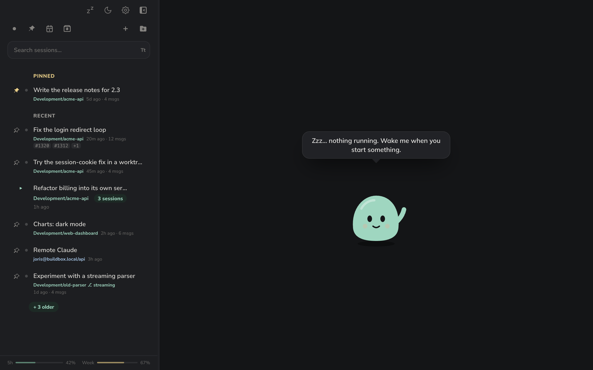
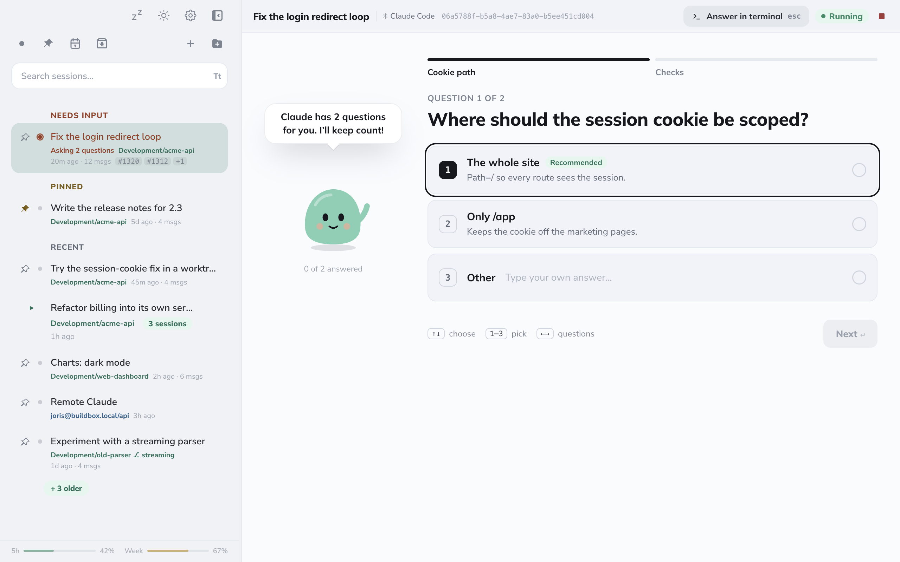
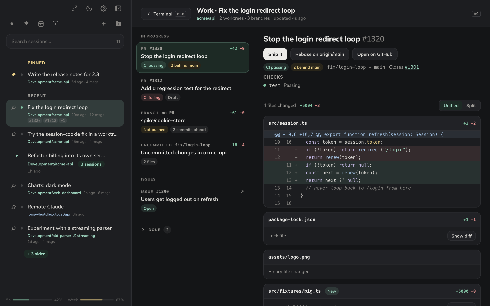

# Switchboard

A calm home for your Claude Code sessions.

Every session from every project in one quiet list. A real terminal beside it. Your hands stay on
the keyboard, and a small jelly friend named Patch keeps you company.


> **This is a fork** of [doctly/switchboard](https://github.com/doctly/switchboard). It has gone its
> own way: fewer panels, more keyboard, and a lot of care for how it feels to sit in all day.

## What it's about

**Focus.** Switchboard shows you what needs you and keeps everything else out of the way. Sessions
sort themselves into *Needs input*, *Working*, *Pinned* and *Recent*, with live dots so you can
tell a busy Claude from a waiting one at a glance. Old sessions fold away behind "+3 older".

**Minimalism.** One list, one terminal, no tabs. Archiving a session also stops it. Picking a
project just starts Claude there. When a feature didn't earn its pixels, it went.

**Keyboard first.** Start a session, jump between them, rename, archive and review without
reaching for the mouse. See [Keyboard](#keyboard).

**A little whimsy.** Archiving throws confetti. Every fifth time, there are stars. Patch lives on the
empty screen and has opinions about the weather, your usage limits, late nights and Dutch
holidays. Poke Patch and see what happens. Then poke again.



## Highlights

### Answer Claude's questions properly

When Claude asks you something, the questions open as a proper sheet instead of a menu in the
terminal: number keys to pick, arrows to move between questions, and an "Other" box to write your
own answer. Patch keeps count. Press `Esc` to answer in the terminal instead.



### See what a session did

`⌘G` opens **Session work** for the session on screen: its pull requests, branches, uncommitted
worktrees and the issues it touched, each with its CI status. Read the diff unified or split, leave
review comments on lines, and hand them back to Claude. Buttons like *Ship it*, *Rebase* and
*Fix CI* type the prompt into the session for you. While a session runs, failing CI on its PRs is
handed to Claude automatically, at most twice per check.



### Start anywhere in three keys

`⌘A`, type a few letters, `Enter`. The project picker fuzzy-matches every project you've used
Claude in, local or remote. `⌘N` starts a quick session in a scratch folder of your choosing.


### And also

- **Remote projects over SSH.** Sessions live in tmux on the other machine, survive a dropped
  link, and reconnect on their own. A card shows what the connection is doing in the meantime.
- **Full-text search** across everything you and Claude ever said, not just the titles.
- **Usage gauges** for your plan's 5-hour and weekly windows, quietly in the corner.
- **Keep awake.** One click on the zzz keeps your Mac from sleeping while Claude works.
- **Light and dark**, following your system or pinned. The terminal has themes to match:
  Switchboard, Ghostty, Tokyo Night, Catppuccin, Dracula, Nord and Solarized.
- **Your terminal, your way.** Font, size and line height apply live. `Shift+Enter` makes a newline,
  holding `Space` works for voice input, and dropping a file pastes its path.
- **Scheduled tasks.** `.claude/commands/schedule-*.md` files with a cron line run on their own.

## Keyboard

**Anywhere**

| Keys | Does |
|---|---|
| `⌘A` | New session: open the project picker |
| `⌘N` | Quick session in your quick-session folder |
| `⌘⇧[` / `⌘⇧]` | Previous / next session (`⌘←` `⌘→` and `⌘↑` `⌘↓` work too) |
| `⌘L` | Move to the session list |
| `⌘G` | Open or close Session work |
| `⌘E` | Archive the session on screen 🎉 |
| `⌘S` | Hide or show the sidebar |
| `⌘F` | Find in the terminal |

**In the session list** (after `⌘L`)

| Keys | Does |
|---|---|
| `↑` `↓` or `J` `K` | Move |
| `Enter` | Open the session, fold a group, or show older ones |
| `R` or `F2` | Rename |
| `E` | Archive (a whole group, on a group header) |
| `A` | New session |
| `Esc` | Back to the terminal |

**In Session work**

| Keys | Does |
|---|---|
| `J` `K` | Next / previous item |
| `N` `P` | Next / previous file |
| `U` | Unified or split diff |
| `C` | Comment on the focused line |
| `Esc` | Back to the terminal |

**In Claude's questions**

| Keys | Does |
|---|---|
| `1`–`9` | Pick an option |
| `↑` `↓` | Move between options |
| `←` `→` or `Enter` | Previous / next question |
| `Space` | Toggle an option, when you can pick several |
| `Esc` | Answer in the terminal instead |

## Run it

Switchboard is macOS only, and this fork doesn't publish builds, so you build it yourself. You need
Node.js 20+ and the Xcode Command Line Tools (`xcode-select --install`).

```bash
npm install
npm start              # build and launch
npm run build:mac      # or package a .dmg into dist/
```

Building, testing and releasing are covered in [CONTRIBUTING.md](CONTRIBUTING.md), and how the code
is laid out in [ARCHITECTURE.md](ARCHITECTURE.md).

## Thanks

Switchboard was created by [Doctly](https://github.com/doctly). Thank you to Ali Basiri and
everyone who contributed to [the original](https://github.com/doctly/switchboard), which this fork
stands on. The flat session list and project picker are adapted from
[Niek Haarman's fork](https://github.com/nhaarman/switchboard).
